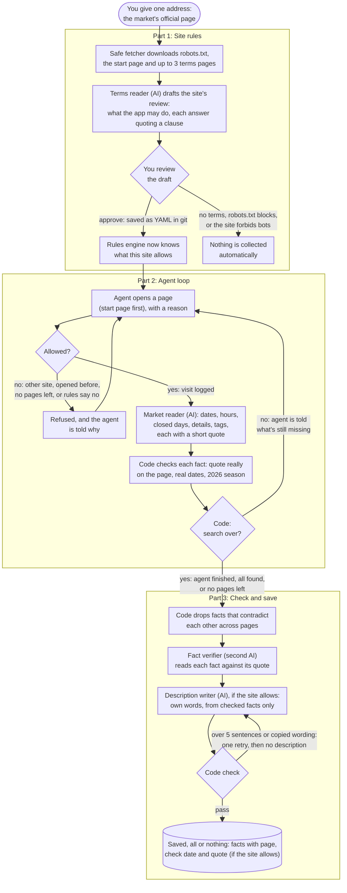
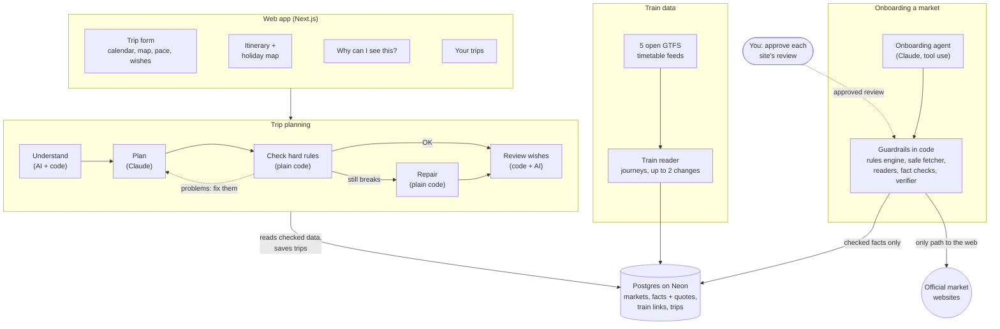
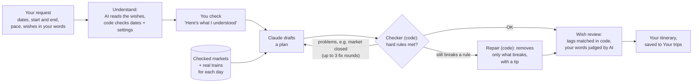

# MerryMapped: Christmas markets trips you can count on

## About
**Your Christmas markets trip, planned reliably around accurate opening hours and train schedules.**

> 
>
> **Built on a legal engine that turns rules and law into code.** Before MerryMapped reads a single
> web page, a rules engine decides whether it may. Each website's robots.txt (including blocks aimed
> at AI crawlers) and terms of use, reviewed against a clause guide grounded in EU copyright and
> text-and-data-mining law, together with the app's own stricter policies, become rules the code
> enforces. Every use (collecting facts, keeping a short quote as proof, writing a summary, showing a
> link) is judged separately, and every decision records its reason, quoting the site's clause where
> one applies. If the rules don't allow reading a page, the code never fetches it.

MerryMapped plans a December trip through the Christmas markets of Germany, Belgium and France,
travelling only by train. Tell it your dates, where to start and end, your pace and your wishes in
your own words. It plans a day-by-day route of markets and real trains and shows it on a map.

The internet is full of Christmas market information that is out of date, copied from other sites or
simply made up. A blog says a market is open on the 24th; it isn't. A trip built on that is ruined.
MerryMapped uses only two sources:

- **Each market's own official website**, read only where that site's terms allow it.
- **Real train timetables**, from open timetable data published by the railways.

Every fact shown can be traced back to the official page it came from and the date it was checked,
with a short quote as proof wherever the site allows it, behind a **"Why can I see this?"** button on
each market. The few facts that couldn't be read automatically were entered by hand from the
official page and are marked as such.

## Two Promises, Enforced in Code

 You never land at a closed market. Every plan is checked against the markets' checked opening days and hours and real train times before you see it.

 The app never uses data it isn't allowed to use. A rules engine decides, before every download from a website, whether the site's robots.txt and terms permit it.

## Technologies
### Front-End


### Back-End


### AI Agent + Generative AI


### Database


### Open Data


### Testing


## Key Features

 Pick dates on a December calendar, tap start and end cities on a map, set your pace (earliest train, time at each market, train time per day, markets per day, day trips) and type wishes like "somewhere medieval, with good mulled wine". A confirm screen shows how it was understood.

 A flowing day-by-day timeline with every train leg, change and wait, the railway that runs it, and travel days and free days where markets are closed.

 The route drawn as a railway with a little train travelling along it.

 A short description written in the app's own words, "Don't miss" details and vibe tiles, all taken from checked facts.

 "Why can I see this?" opens each fact's source page and check date, its quote with an English translation (where the site allows quotes), and what that website's terms allow the app to do, with the reason.

 Each wish is judged against the planned markets' checked facts, and the ones the trip grants are shown.

 Every planned trip is saved until you delete it; deleting removes everything and shows a receipt.

## AI Components: Agent, AI Calls and Code Guardrails


  - Claude runs as a **tool-use agent** that explores a market's official website to find its facts. It has two tools: `open_page` (open one page, with a one-line reason) and `finish` (end the search with a summary).
  - The agent **never sees the pages' text**. A separate market reader pulls out the facts, code checks them, and the agent gets back only the facts found and dropped, what is **still missing** (for example the closing date or the hours), the page's links and the pages left. So instructions hidden in a page can't steer it.
  - Guardrails in code: only pages on the market's own site, each page opened once, at most 10 pages and 15 rounds, and **every page goes through the rules engine and the safe fetcher**, so the agent can never read what the site doesn't allow.
  - **Code can end the search, not only the AI:** besides the agent calling `finish`, code stops it once the dates, hours and address are all found, when the pages run out, or after 3 extra pages spent looking for the address.

How a market is onboarded, step by step:




  - Each of these is one Claude call with **structured JSON output** checked against a schema, and each one's instructions treat pages, wishes and facts as data, never as instructions:
  - **Site review drafter:** reads a site's terms pages against a clause guide and drafts what the app may do, quoting each clause. A person approves it before use.
  - **Market reader and fact verifier:** the reader turns a page into typed facts with quotes; a second AI checks each fact against its own quote.
  - **Description writer:** a short market description in the app's own words.
  - **Request reader:** reads the typed text into the request: wishes into tags, plus any dates or cities mentioned.
  - **Planner:** drafts the day-by-day route from checked facts and real trains, with a short "why you'll love it" line for each market.
  - **Wish reviewer:** judges each wish against the planned markets' facts.


  - The AI drafts; **plain code decides**. A checker holds every plan to hard rules, problems go back to the AI for up to 3 rounds, and a repair step in code removes anything that still breaks a rule, with a tip.
  - Code also checks every fact (quote really on the page, real dates, no contradictions), rejects descriptions that copy more than five words in a row from the site, and keeps the traveller's settings within allowed ranges. The AI never has the last word.

## Application Architecture

The main parts and how data flows between them:




 - Every use of a website is a separate **purpose**: read its rules, collect facts, keep short quotes as proof, write a summary, show a link. The engine answers each one with an explainable decision, and the first rule that applies decides:
   1. App policy: never copy descriptions or photos, whatever the site says.
   2. robots.txt blocks the page for our bot, **or for any well-known AI crawler** (a robots.txt that can't be fetched counts as a block).
   3. Otherwise, reading a site's robots.txt and terms is allowed, so they can be reviewed.
   4. Instagram is link-only (its terms forbid automated collection).
   5. No approved review for the site yet: nothing else is allowed.
   6. The site's terms forbid bots: nothing that reads pages.
   7. Keeping quotes or writing a summary needs collecting facts to be allowed too.
   8. Otherwise, the approved review's answer for that purpose; with no answer, the default is no.
 - Site reviews are drafted by AI from the site's terms pages against a clause guide, then checked and approved by a person before the engine uses them. Each answer quotes the clause it relies on, and every engine decision records its reason and the kind of rule behind it.


 - The **safe fetcher** is the only code path to the web. It asks the engine before every request, sends a named user agent, waits at least 5 seconds between requests to the same site (longer if robots.txt asks), limits size and redirects, and logs every attempted visit.
 - The market reader turns each page the agent opens into typed facts: opening and closing dates, weekly hours, closed days, special hours, address, details and tags. **Each fact must carry a short quote** from the page, used to check it (and kept as proof only where the site allows quotes). Code then drops anything that fails:
   - the quote isn't really on the page, or is too long;
   - the dates or times aren't real, or aren't stated in the quote;
   - the year isn't stated, or the dates fall outside the 2026 season;
   - facts contradict each other (two opening dates, an opening date after the closing date, or hours that clash on the same weekday).
 - A second AI verifier reads each fact against its own quote, and code applies its verdicts. Market descriptions are written in the app's own words, and code rejects any that share more than five words in a row with the site.


| Feed | Source | Licence |
|---|---|---|
| Eurostar | Eurostar | Licence Ouverte 2.0 |
| SNCF | SNCF Voyageurs | ODbL |
| German long-distance | DELFI e.V. via gtfs.de | CC BY 4.0 |
| German regional | DELFI e.V. via gtfs.de | CC BY 4.0 |
| SNCB | NMBS/SNCB, via transportdata.be | free download (licence not stated) |

 - A reader written from scratch (no transit library) matches station names across feeds (for example "Bruxelles-Midi" and "Bruxelles Midi") and finds the journeys between every pair of cities (the market cities plus Brussels as a train hub) for each day from 15 to 31 December, direct or with up to two changes, respecting boarding rules.
 - When a feed doesn't yet cover a December day, the same weekday's trains are used and clearly marked as an estimate. Nothing about trains is entered by hand.


 - Claude drafts a route from the request, the markets' checked facts and the real train options. A **checker written in plain code** holds every draft to hard rules:
   - one day per date, starting and ending where asked;
   - each market open on that day, with enough time while it's open, and not repeated on the same day;
   - a real train for every journey, within the traveller's pace;
   - the route moves onward (no doubling back), new markets before second visits, and at most 2 days at a market while others still have days to spare.
 - Problems go back to the AI to fix, for up to 3 rounds. If something still breaks the rules, a **repair step in code** removes only what breaks and suggests the smallest change to a setting that would fit it back in.

How a trip is planned:




 - **Next.js** (App Router) with **React** and **TypeScript**, styled with **Tailwind CSS**; Fraunces and Nunito fonts via `next/font`.
 - Maps drawn in **SVG** from Natural Earth country shapes, with SVG path animation for the route and the train; **Canvas** for the sparkles and the night sky; **Web Audio API** for the optional sound effects (off by default).
 - Next.js rewrites proxy `/api` to the backend, so the browser talks to one address.


 - **FastAPI** with Pydantic models, and dependency injection for the database and the access code.


 - **PostgreSQL** on **Neon** (serverless), through **SQLAlchemy 2** and **psycopg 3**.
 - Tables for markets, facts (each with its page, check date and, where allowed, its quote), train links and trips; JSON columns for train journeys and itineraries.


 - About 390 **pytest** tests; AI calls are replaced with pretend answers and the database with in-memory SQLite, so the tests run in seconds.
 - ESLint and TypeScript checks for the frontend.

## Privacy and Security

 One access code protects the whole API; it is compared in constant time, and if none is set, everything is refused.

 Trips store only the request and the itinerary: no names, accounts or emails.

 Deleting a trip removes it completely; the receipt is shown once and not stored.

 Secrets live only in an untracked `.env` file.

## Getting Started
### Prerequisites


### Installation
1. Clone the repo
```sh
git clone https://github.com/Pallavi25Kishore/MerryMapped.git
```

2. Create `backend/.env` with your own values
```sh
ANTHROPIC_API_KEY=<anthropicapikey>
DATABASE_URL=<neonpostgresurl>
ACCESS_CODE=<anycodeyouchoose>
```

3. Set up the backend
```sh
cd backend
python3 -m venv .venv
.venv/bin/pip install -r requirements-dev.txt
```

4. Run the backend tests
```sh
.venv/bin/python -m pytest
```

5. Load the data (a new database starts empty). Download the timetables and work out the journeys. Then, for each market, draft its site review, read it and approve it by committing it, and collect its facts (the city must be one of those in `backend/app/trains/stations.py`)
```sh
.venv/bin/python -m app.trains.download
.venv/bin/python -m app.trains.build_links
.venv/bin/python -m app.draft_review <market start page>
.venv/bin/python -m app.collect_market <market start page> --name "<name>" --city <city> --country <DE|BE|FR>
```
The German feeds cover only the next 30 days, so download them again on or after 1 December for 15 to 31 December.

6. Start the backend
```sh
.venv/bin/uvicorn app.main:app --port 8000 --reload
```

7. In another terminal, install and start the frontend (it talks to the backend at http://127.0.0.1:8000 unless `BACKEND_URL` is set), then open http://localhost:3000
```sh
cd frontend
npm install
npm run dev
```

8. The background picture isn't included because of its licence; see `frontend/README.md` to download it.

## Credits
Train timetables: Eurostar, SNCF Voyageurs, DELFI e.V. via gtfs.de and NMBS/SNCB. Country shapes:
Natural Earth. Background designed by Magnific. Market facts belong to each market's official
website, linked from every market.
